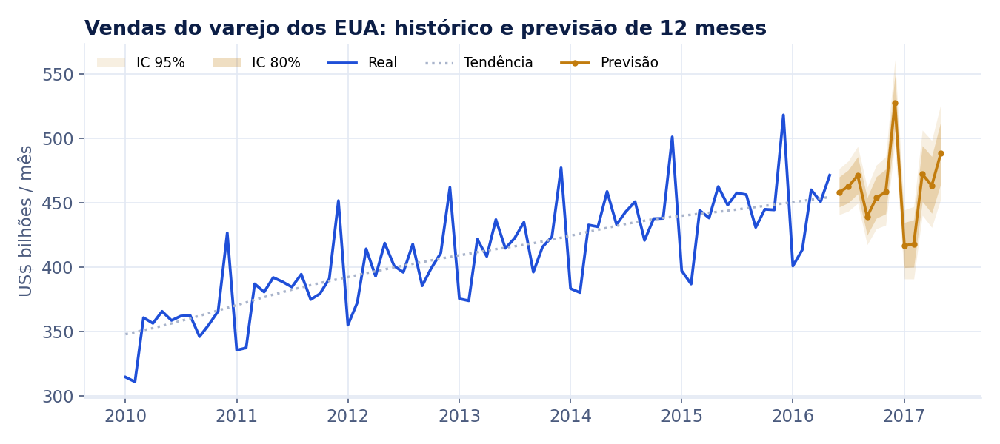
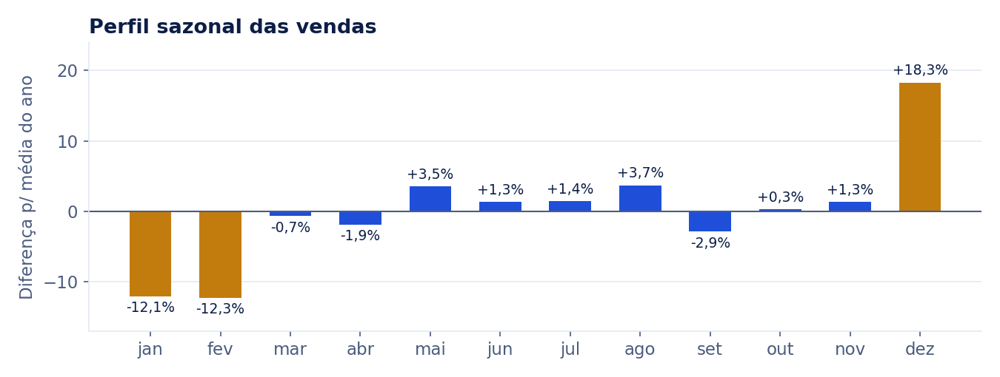

# Quanto o varejo vai vender nos próximos 12 meses

    

**[Ver o dashboard interativo](https://bishoppython.github.io/previsao-vendas-varejo/)**

## 💡 Resumo do projeto

Construí uma previsão de 12 meses para as vendas do varejo dos EUA, com intervalos de confiança e validação honesta. Em 5 testes com dados que o modelo não viu, o **SARIMA errou em média 1,42%** ao prever um ano inteiro, **2,8 vezes menos** que repetir o ano anterior. A previsão indica **+2,5% de crescimento** e um pico de dezembro **18% acima da média**.

## ❓ Problema de negócio / contexto

Compras, estoque, contratação temporária e fluxo de caixa dependem de quanto se espera vender. Uma previsão errada para cima gera estoque parado; para baixo, ruptura e venda perdida. As perguntas são:

1. Como as vendas devem se comportar nos próximos 12 meses?
2. Existem padrões sazonais e tendências de longo prazo?
3. Quanto se pode confiar na previsão, e qual é o intervalo provável?

## 📊 Dados utilizados

| Item | Detalhe |
|---|---|
| Fonte | Vendas mensais do varejo dos EUA (US Census Bureau), distribuídas como [dataset de exemplo do Prophet](https://github.com/facebook/prophet/blob/main/examples/example_retail_sales.csv) |
| Período | Janeiro de 1992 a maio de 2016: 293 meses, sem lacunas |
| Unidade | Milhões de dólares por mês, sem ajuste sazonal |

**Tratamentos e verificações:**

- **Calendário completo:** gerei um calendário mês a mês em SQL e cruzei com a série para garantir que não falta nenhum mês. Um teste automatizado verifica isso a cada execução.
- **Escala logarítmica:** a sazonalidade cresce junto com o nível das vendas (multiplicativa), então os modelos trabalham em log e voltam para a escala original na saída.

## 🛠️ Metodologia e ferramentas

```
download + checksum → calendário + série (SQL) → marts anual e sazonal → STL → backtest de 3 modelos → previsão final → dashboard
      Python                  DuckDB                     DuckDB          statsmodels    statsmodels       statsmodels      Plotly
```

1. **Exploração em SQL:** crescimento anual e perfil sazonal, com cada mês comparado à média do próprio ano.
2. **Decomposição STL** (robusta, em log): separa tendência, sazonalidade e ruído, e mede o choque de 2008.
3. **Comparação de modelos com backtest de origem móvel:** cada modelo treina até maio de um ano e prevê os 12 meses seguintes, em 5 janelas de 2011 a 2015. Um teste garante que o treino nunca enxerga o período previsto.
   - **Sazonal ingênuo (base):** repete o mesmo mês do ano anterior. Todo modelo precisa vencer esta régua.
   - **Holt-Winters (ETS)** com tendência amortecida.
   - **SARIMA**(1,1,1)(0,1,1)₁₂, um modelo clássico para séries mensais sazonais.
4. **Métricas:** MAPE, o erro percentual que o negócio entende, e MASE, o erro relativo à base ingênua (abaixo de 1 é melhor que a base).
5. **Previsão final** com o melhor modelo ajustado em toda a série, com intervalos de 80% e 95%.

**Ferramentas:** Python, SQL (DuckDB), pandas, statsmodels, Plotly, Matplotlib, pytest, GitHub Actions.

## 📈 Principais insights e resultados

### 1. O SARIMA vence a régua com folga

| Modelo | MAPE médio | Pior janela | MASE |
|---|---:|---:|---:|
| **SARIMA** | **1,42%** | 2,18% | 0,38 |
| Holt-Winters (ETS) | 1,47% | 2,48% | 0,40 |
| Sazonal ingênuo (base) | 3,95% | 6,56% | 1,07 |

Os dois modelos estatísticos ficam muito próximos, um bom sinal de robustez. O SARIMA foi escolhido por ter o menor erro médio, o menor erro na pior janela e intervalos de confiança nativos.

### 2. Previsão: +2,5% nos próximos 12 meses



- **Total previsto** de junho de 2016 a maio de 2017: **US$ 5,53 trilhões**, 2,5% acima dos 12 meses anteriores (US$ 5,40 trilhões).
- **Dezembro de 2016** deve ser o maior mês: cerca de US$ 528 bilhões (intervalo de 80%: US$ 507 a 549 bilhões).
- **Calibração:** no backtest, 95% dos valores reais caíram dentro do intervalo de 80%. Os intervalos são conservadores, o que é aceitável para planejamento, mas há espaço para calibrá-los.

### 3. Um ciclo anual bem marcado



**Dezembro vende 18,3% acima da média do ano.** Janeiro e fevereiro vendem cerca de 12% abaixo. Maio e agosto têm picos menores (+3,5% e +3,7%), e setembro é o mês fraco do segundo semestre (−2,9%).

### 4. Tendência de longo prazo e choques

- **Crescimento médio de 4,3% ao ano** entre 1992 e 2015.
- **Crise de 2008:** a tendência caiu **7,0%** entre dezembro de 2007 e agosto de 2009 e só voltou ao nível anterior em dezembro de 2010. Em 2009, as vendas anuais caíram 7,4%.
- Desde 2014 o crescimento desacelera (4,2% em 2014 e 2,3% em 2015), o que é coerente com a previsão de +2,5%.

### Recomendações

1. **Use o intervalo, não só o número.** Planeje o estoque-base pelo limite inferior do intervalo de 80% e deixe compras complementares para o cenário central. Isso reduz estoque parado sem arriscar ruptura.
2. **Antecipe o ciclo de dezembro e janeiro:** reforço de estoque e equipe de outubro a dezembro, e plano de caixa para a queda de cerca de 12% em janeiro e fevereiro.
3. **Retreine todo mês** e acompanhe o erro real contra o previsto. Se o MAPE passar de 2,5% (o pior valor do backtest), revise o modelo.
4. **Próximo passo:** incluir variáveis externas (feriados móveis, confiança do consumidor, promoções) para captar choques que o histórico sozinho não antecipa.

### Limitações

- Os modelos usam **só o histórico de vendas**. Choques como o de 2008 só aparecem depois de acontecerem.
- A série é **nacional e agregada**. Para uma rede específica, o mesmo método se aplica por loja, região ou categoria, mas o erro tende a ser maior.
- A previsão de junho de 2016 a maio de 2017 **não foi comparada aqui com os valores reais**. A validação vem do backtest.

## 🚀 Como executar o projeto

**Pré-requisitos:** Python 3.11+ e `make`.

```bash
git clone https://github.com/bishoppython/previsao-vendas-varejo.git
cd previsao-vendas-varejo
pip install -r requirements.txt
make all        # baixa, transforma, decompõe, roda o backtest, prevê, gera o dashboard e as imagens, e testa
```

**Saídas:**

- `docs/index.html`: dashboard.
- `outputs/forecast.csv`: previsão mês a mês com intervalos de 80% e 95%.
- `outputs/backtest.csv`: erro de cada modelo em cada janela.
- `outputs/metrics.json`: todas as métricas citadas neste README.

**Publicar o dashboard:** em *Settings › Pages*, escolha a branch `main` e a pasta `/docs`.

```
├── sql/               calendário, série mensal e marts anual e sazonal
├── src/               ingestão, transformação, modelos/backtest e dashboard
├── tests/             testes de dados, de vazamento e de integridade da previsão
├── docs/              dashboard publicado e imagens do README
└── outputs/           previsão, backtest e métricas
```

## 🤝 Contato

**Anderson Bispo** · Engenheiro de Dados Sênior
[LinkedIn](https://www.linkedin.com/in/anderson-bishopx/) · [Portfólio](https://bishoppython.github.io) · [GitHub](https://github.com/bishoppython)
